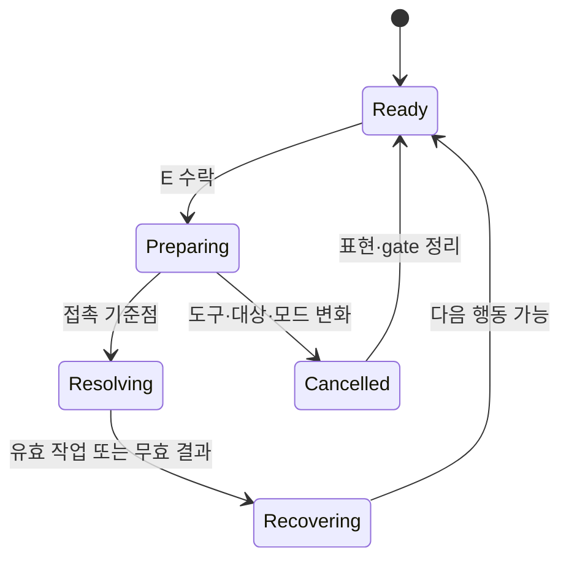
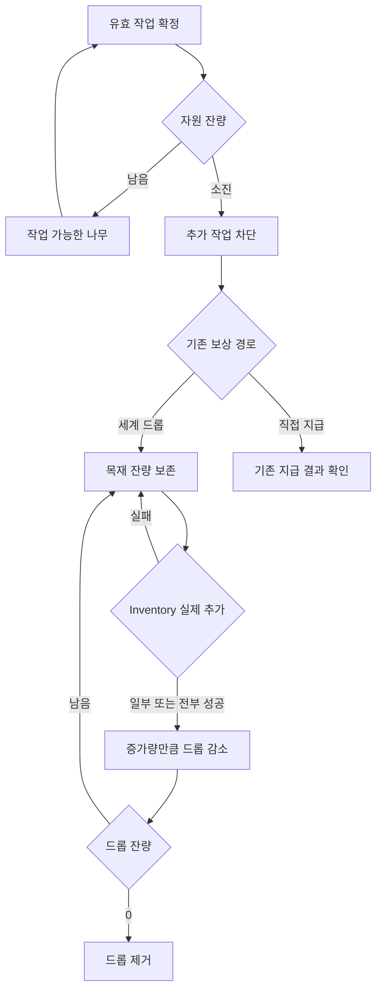

# Project P.A. — 첫 나무 벌목의 구현 설계 지식

연결: Opening Demo Canon v2 §4·5·6·21·22·23·26, ACT-01/02, PLAY_UNIT_CASES 사례 A. 원작 근거: [Dinkum 역분석](DINKUM_LOGGING_REVERSE_ANALYSIS_2026-10-12.md)의 DL-O01–06·DL-M01–04·DL-I01–03.

**이 문서의 C를 제외한 상태·연결·표현·검수 제안은 H다. 원작 내부 구현을 재구성한 것이 아니며, P.A. 코드 변경이나 실행 검증을 완료한 것도 아니다.** 기존 PlayerController, CameraController, PlayerInteraction/IInteractable, Inventory/ItemInstance, Hotbar, EquipmentSystem, 자원 대상, AudioManager, Save의 권위를 재사용하는 방향이다. 실제 반환값·호출 순서·정리 경로는 구현 담당자가 현재 코드에서 확인해야 한다.

## 1. 구현이 만들어야 할 한 번의 경험

플레이어는 나무와 그 앞의 바닥을 보고 접근한다. 도끼 슬롯을 골랐을 때 실제 손에 같은 도끼가 나타난다(C). 현재 E가 가리키는 대상을 읽고 작업을 시도한다. 몸과 도구가 나무 쪽으로 움직이고, 유효 작업이면 나무의 상태와 도구 비용이 바뀐다(C). 작업이 계속 가능하면 다시 시도할 수 있다. 자원이 소진되면 그 사실을 세계에서 읽고, 나온 목재 또는 실제 지급된 목재의 상태를 확인한다. 바닥 목재는 E의 문맥 우선순위에 따라 줍는다(C). 마지막에는 걷기·다음 나무·줍기 중 원하는 행동으로 돌아간다(H).

품질의 핵심 질문은 네 가지다(H): **내 입력이 수락됐는가? 어느 나무에 작업했는가? 실제로 어떤 상태가 바뀌었는가? 지금 다음 행동을 할 수 있는가?** 데이터와 화면/음향이 같은 답을 해야 한다.

## 2. Canon으로 고정된 것과 실험할 것을 구분한다

| C — 바꾸지 않는 규칙 | 이 연구에서 아직 결정하지 않은 H/U |
|---|---|
| 숫자 1–9/휠로 hotbar 선택, 실제 held 도구, X로 집어넣기 | 도끼 준비/휘두름/회복 duration, 애니메이션 phase 값 |
| E 문맥 행동, 바닥 줍기→명시적 interactable→유효 tool target→자연 행동 | 타깃 허용 거리·각도·보정·입력 반복/버퍼 정책 |
| 허공/잘못된 대상 비용 0, 유효한 나무 작업 성공만 −1 | 자원당 작업 횟수, 마지막 작업의 세계 표현, 목재 수량 |
| 필수 개척 성공 행동 수 대비 Starter 내구도 약 25–35% 여유, 실 동선 후 튜닝 | 쓰러짐/그루터기/축소 중 어떤 독자적 소진 표현을 쓸지 |
| readable third-person, 나무 obstruction 대응 | camera shake, hitstop, IK, 자동 줌의 채택 여부/수치 |
| animation·impact timing·SFX·drop/reward feedback, minimal HUD | 소리의 실제 자산·변형 폭·상대 음량·잔향·알림 시간 |
| 기존 Inventory·자원·Save 등 권위 재사용 | 이들이 즉시 지급/드롭/부분 삽입을 현재 어떻게 처리하는지 |

DL-M02의 0.866667초는 설정값 후보로 복사하지 않는다. 원작 스태미나/음식/라이선스/도구 등급 체계를 추가하는 작업도 이 연구의 범위가 아니다.

## 3. ‘한 번의 타격’과 ‘나무/목재의 수명’을 따로 본다 H

캐릭터는 회복을 끝내도 나무 소진 표현이나 목재 착지 효과가 남을 수 있다. 반대로 캐릭터가 회복 중이어도 이미 소진된 나무는 추가 유효 작업을 받을 수 없다. 이 관계를 동일한 busy bool 하나에 압축하면 중복 타격 또는 불필요한 잠금이 생긴다.

### 캐릭터 행동의 개념 상태 H

`Resolving`은 동작을 이해하기 위한 경계다. 새 장기 상태 머신/저장 데이터를 반드시 만들라는 요구가 아니다. 기존 작업 경로에서 어느 호출이 실제 성공을 확정하고, 어느 표현이 그 결과를 소비하는지를 먼저 표시한다.

### 세계 자원과 획득의 개념 분기 H

드롭 잔량 0이면 드롭을 제거한다. 직접 지급형의 가방 부족/재시도는 현재 대상 권위의 정책을 확인해 보존한다. 그 정책을 읽기 전에는 소진된 자원과 실패 보상을 임의로 삭제하거나 무한히 재지급할 수 있게 만들지 않는다. 도식의 분기들은 Dinkum에서 관찰한 내부 상태가 아니다.

## 4. 한 번의 E가 넘겨야 할 최소한의 의미 H

입력을 수락할 때 실제 actor·target·tool instance·행동 종류를 안정적으로 연결한다. 다음 정보가 기존 함수 간에 일관되게 전달되는지 확인한다. 이름은 설계 의미이며 새 C# API 이름을 지정하지 않는다.

| 의미 | 확인할 이유 | 권위·보존 경계 |
|---|---|---|
| 현재 input owner | UI/배치/전환이 소유한 E가 벌목을 만들지 않게 함 | 기존 input/modal 경로 |
| 보여준 후보와 실행 후보 | 프롬프트는 A인데 B를 치는 일을 막음 | 기존 PlayerInteraction 후보 판정 |
| 시작 도구의 실제 instance | 작업 중 슬롯 변경 후 새 도구에 비용을 주지 않음 | 기존 Inventory/Equipment 참조 |
| 시작 대상과 아직 유효한 대상 | 회복 중 옆 나무로 성공을 옮기거나 소멸한 대상에 지급하지 않음 | 기존 자원 대상 |
| 아직 결과 확정 전인지 | animation callback/재입력/중단이 동일 작업을 다시 확정하지 않음 | 기존 action gate의 최소 상태 |
| 실제 작업 결과 | 성공/무효/소진과 비용을 표현에 전달 | 대상 작업의 결과. 표현 계층이 새 성공 권위가 되지 않음 |
| 실제 Inventory 증가량 | 드롭 소멸/획득 알림/목재 수량을 일치시킴 | 기존 Inventory 반환 의미 확인 |

필요한 추적 ID는 개발용 일회성 상관값으로만 둔다. 새 Save schema나 자원/Inventory의 두 번째 장부를 만들 필요는 없다.

## 5. 접촉 시점에 도메인과 표현을 연결하는 방법 H

DL-O03·04는 도구 끝이 일부 가려져도 접촉 근처 표현이 보일 수 있음을 보여준다. 그 표현이 설득력을 가지려면 P.A.에서 **보이는 사건과 실제 성공 결과의 순서**가 일치해야 한다.

현재 코드의 즉시 작업 호출과 애니메이션 재생 순서를 먼저 그린다. 예를 들어 E를 누른 즉시 나무가 사라지고 나중에 도끼가 빈 공간을 치면, 시각적 원인보다 세계 결과가 먼저 나타난다. 대상의 처리 시점을 무조건 바꾸기 전에 다음 두 선택을 검토한다.

| 선택 H | 적용 조건 | 필요한 검증 |
|---|---|---|
| 기존 작업 호출을 시각적 접촉 기준점에 정확히 한 번 연결 | 대상·도구가 기준점까지 유효한지 재검증할 수 있고, 중단/씬 전환/도구 변경에서 gate를 정리할 수 있음 | 기준점 이전 취소 비용 0, 기준점 이후 중복 0, 마지막 작업과 도구 파손의 순서 |
| 즉시 도메인 결과를 유지하고 표현이 그 결과를 받아 접촉과 소진을 일관되게 보여줌 | 기존 처리의 변경 비용이 크며, 소진된 대상의 표현/보상 연결을 안전하게 유지할 수 있음 | 대상이 미리 사라지는 노출, 목재/알림의 조기 등장, ‘취소’ 뒤 이미 발생한 세계 결과 |

첫 선택은 접촉 동기화를 이해하기 쉬운 실험안이다. 실제 호출 그래프·원자성·현재 취소 정책을 확인하고 선택한다. 애니메이션 이벤트를 쓰더라도 이벤트가 Inventory 지급과 대상 작업을 중복 호출하지 않게 한다. 두 번째 선택에서 원본 자원 authority를 복제한 가짜 자원을 만들거나 보상 장부를 새로 만들지 않는다.

판정 이후 표현이 중단되면 **이미 확정된 자원·비용을 표현 취소처럼 되돌리지 않는다.** 판정 이전 취소와 판정 이후 회복 중단은 서로 다른 경계다. 그 차이는 ACT-01/02의 ‘시도/결과/회복’을 더 정밀하게 사용하는 이유다.

## 6. 행동별 시청각 피드백 계약 H

아래 연결은 P.A. 실험안이다. 원작 음향은 이번 자료에서 확인하지 못했다.

| 실제 경계 | 몸·발·도구 | 대상/효과/환경 | 카메라·UI | 음향의 의미 | 피해야 할 오해 |
|---|---|---|---|---|---|
| 접근 | 이동 감속과 도끼를 든 자세의 연결. 발이 나무 안으로 들어가지 않음 | 줄기 앞 작업 공간과 바닥이 읽힘 | 작업 대상과 앞 지면이 같이 보임 | 환경/발걸음 | 화면상 도끼가 있는데 손은 빈 상태 |
| E 수락 | 손·도구가 향할 방향을 읽히는 첫 자세 변화 | 아직 세계 보상 성공을 표현하지 않음 | 현재 후보와 실행 대상 일치 | 시도/도구 움직임 신호 | 허공에도 목재 획득 신호 |
| 접촉 기준점 | 도구 궤적이 대상의 읽을 수 있는 면으로 들어옴. grip과 발 기준 유지 | 실제 유효 작업이면 국소 반응. 필요시 독자적 재질 입자 | 읽기 어려운 접촉을 카메라 변화로 더 가리지 않음 | 유효 작업과 무효 시도를 구분 | 도구 끝은 다른 방향인데 효과만 나무에서 발생 |
| 비최종 유효 작업 | 앞쪽 자세와 회복. 잔류 효과 수명과 다음 행동 gate 분리 | 같은 나무의 남은 작업 가능성이 읽힘 | 성공 비용을 실제 instance와 맞춤 | 일반 작업 피드백 | 효과 조각을 줍는 목재로 오인 |
| 마지막 유효 작업 | 같은 동작 문법을 유지하되 실제 소진 결과와 연결 | 추가 작업 즉시 차단. 선택한 소진 표현과 기존 보상 경로 일치 | 타깃 프롬프트가 소진 뒤 낡은 상태로 남지 않음 | 최종 세계 사건 신호 | 소진=Inventory 획득으로 오인 |
| 세계 목재 생성 | 캐릭터의 회복과 별개로 유지 가능 | 생성 위치·잔량·착지 공간. 바다/지형/풀 속 유실 검증 | 목재를 볼 수 있는 구도. 읽을 수 있는 줍기 후보 | 세계에 물건이 나왔다는 신호 | 생성 직후 ‘내 가방 획득’ 표시 |
| E 줍기 성공 | 필요하면 짧은 독자적 반응. 이동 리듬과 비교 검증 | 실제 추가된 양만 드롭에서 감소 | item identity·실제 증가량·Inventory/Hotbar 정합 | 실제 획득 신호 | 부분 추가를 전부 추가로 알림 |
| E 줍기 실패 | 입력은 수락됐고 실패 이유를 읽을 수 있음 | 드롭 잔량 유지 | 가방 부족 등 현재 이유. 최소 안내 | 실패/안내 의미 | 성공음과 드롭 소멸 |
| 다음 행동 가능 | 걷기·방향 전환·다음 작업으로 자연스럽게 이어짐 | 잔류 효과가 새 목재/대상을 가리지 않음 | 낡은 후보·잠금 정리 | 앞 작업 잔향이 새 결과를 압도하지 않음 | 자세는 끝났는데 E/WASD가 이유 없이 막힘 |

‘입력 수락음’, ‘swish’, ‘유효 접촉음’, ‘소진음’, ‘착지음’, ‘획득음’을 모두 필수 별도 자산으로 만들라는 뜻은 아니다. 각 소리가 어떤 사실을 전달하는지 정하고, 겹쳐 쓰는 경우에도 무효 작업/미획득을 성공으로 들리게 하지 않는 것이 계약이다. 소리 변형·거리 감쇠·믹싱 수치는 실제 자산과 플레이에서 정한다.

## 7. 튜닝은 초 값보다 관계부터 시작한다 H

| 튜닝 축 | 먼저 볼 관계 | P.A. 측정/판정 방법 |
|---|---|---|
| 접근→첫 행동 | 이동을 끝내기 전에 도구가 엉뚱한 줄기를 향하지 않는가 | 첫 방문의 기본 카메라·실제 WASD/E 기록 |
| 준비→휘두름 | 방향이 읽히면서 입력 수락이 늦다고 느껴지지 않는가 | 입력 표시와 첫 화면 변화를 함께 기록. 준비 길이만 다른 후보 비교 |
| 휘두름→접촉 | 실제 성공과 도구/대상/효과의 공간·시간 관계가 일치하는가 | 작업 결과 로그와 접촉 표식/음향을 같은 캡처에서 대조 |
| 접촉→회복 | 발과 grip이 무너지는가, 이미 정리된 자세가 조작을 붙잡는가 | 무음/효과 축소 보기와 실제 입력 보기 모두 비교 |
| 비최종→최종 | 마지막 작업을 일반 작업과 구분할 수 있는가 | 남은 작업 수를 숨긴 정상 GameView에서 소진을 설명하게 함 |
| 소진→목재 | 세계 변화의 원인과 나온 물건의 위치를 추적할 수 있는가 | 소진 전후 무편집 구간, 풀/단차/가림 조건 포함 |
| 목재→가방 | 실제 증가량과 피드백이 같은가 | Inventory 전후·드롭 잔량·알림 대조 |
| 획득→다음 | 다음 나무/이동/줍기의 문맥 전환이 예상 가능한가 | 마지막 타격 직후 새 E와 방향 전환을 기록 |

숫자를 정할 때 phase의 의미·시간 기준·기존 gate를 함께 기록한다. animation 전체 duration과 재입력 가능 시간, VFX 수명은 같은 숫자가 아닐 수 있다. 원작의 52프레임은 이 표의 어떤 P.A. 설정값도 자동으로 결정하지 않는다.

## 8. 가장 중요한 실패 분기 H/C

| 상황 | 실제 결과/비용 | 상태와 표현의 정리 |
|---|---|---|
| 허공 / 잘못된 도구 | 유효 작업 없음, 내구도 0(C) | 시도/불가를 구분하고 유효 접촉·소진·획득 신호를 내지 않음 |
| 나무 옆 바닥 목재가 E 후보 | 바닥 pickup 우선(C). 나무 작업/도끼 비용 없음 | 프롬프트와 실행이 같은 후보. 자동 연타로 pickup과 벌목이 섞이지 않는지 확인 |
| 작업 중 슬롯 선택/X | 시작 도구로 완료하거나 기준점 전 취소하는 명시적 정책 H | 새 선택 instance에 비용 이전 금지. 선택은 남고 손은 비울 수 있음(C) |
| 기준점 전 대상 소멸/이탈 | 실제 성공 없으면 비용/보상 없음 | 기존 참조 유효성 재검증, 남은 이벤트 무효화, gate 정상 복귀 |
| 성공 후 모션 중단 | 이미 확정된 결과는 정확히 한 번 유지 | ‘취소’가 성공 비용과 자원을 다시 확정/환원하지 않음 |
| 마지막 타격 후 계속 E | 소진 대상에 추가 유효 작업/드롭 없음 | 새 문맥 후보를 다시 읽음. 다음 나무로 오래된 입력을 임의 전이하지 않음 |
| 마지막 타격에서 도끼 파손 | 마지막 성공 비용·자원 결과를 기존 파손 규칙과 일치시킴 | 같은 도끼/대상 결과가 손·hotbar·소진 표현에 이어짐. 유효한 마지막 결과 유실 금지 |
| 가방 가득 참 | 이미 나온 세계 드롭 보존(H), 실제 추가량 0 | 실패 이유를 알림. 공간 확보 후 같은 드롭 재시도 가능 |
| 일부 수량만 추가 가능 | 실제 Inventory 추가량 δ만큼 감소(H) | 남은 드롭과 UI가 합계를 보존. δ=0이면 획득 성공 신호 없음 |
| 수풀/단차/물가 드롭 | 생성되었으나 회수 불가능한 자원은 데모 진행 문제 | 기존 생성/충돌 경로에서 회수 가능 위치 확인. 새 월드 권위 추가 없이 해결 |
| UI/씬 전환 중 이벤트 도착 | input owner·활성 씬·현재 action 조건 확인 | 늦은 callback이 새 액션/새 대상에 성공을 붙이지 않음 |

초기 도구 여유는 **유효 작업 성공 횟수**로 계산한다(C). 목재 수량이나 E 입력 횟수로 바꿔 세지 않는다. 가방 부족이 허공 비용과 같은 규칙이라는 추론도 하지 않는다. 이미 유효 작업이 확정되어 드롭을 만든 경우와 아직 지급이 성립하지 않은 직접 지급형의 정책은 각각 확인해야 한다.

## 9. 플레이 검증 기준 — 전부 미실행 H

이 표는 Unity 구현 후 수행할 검수다. 원작이나 P.A.에 대한 PASS 표가 아니다. 기본 게임 화면과 짧은 개발 로그를 함께 쓰되, 개발 로그/validator 패널을 제품 HUD로 남기지 않는다(C).

| ID | 실제 플레이 시나리오 | 데이터 판정 | 플레이 품질 판정 |
|---|---|---|---|
| Q-DL01 | 도끼 슬롯 선택→X→다시 들기→나무 접근 | 선택/held instance 일치. X는 가방 제거가 아님 | 손에 있는 도구와 다음 E 의미를 설명할 수 있음 |
| Q-DL02 | 걷기/달리기 뒤 첫 나무에 멈춰 E | 보여준 후보와 실제 target 일치 | 감속·발·grip·준비 자세가 연결되고 방향이 읽힘 |
| Q-DL03 | 허공→오도구→유효 작업 | 비용 0/0/−1(C), 유효 작업만 자원 변화 | 무응답·불가·유효 접촉을 구별함 |
| Q-DL04 | 같은 나무 비최종 타격 반복 | 각 성공 정확히 한 번. 시작 도구 비용 정합 | 반복마다 도구·접촉·대상 반응·음향의 관계가 같음 |
| Q-DL05 | 정면·측면·풀/줄기 가림에서 타격 | 의도한 나무가 실행 대상 | 손·도구·발·앞 지면·접촉을 읽음. 효과가 가림을 더 키우지 않음 |
| Q-DL06 | 준비/접촉/회복 각각에서 숫자키/X | 명시한 완료/취소 정책, 다른 instance 비용 0 | 손 도구 순간이동·발 슬라이딩·잔류 잠금 없음 |
| Q-DL07 | 준비 중 대상 소멸 / 성공 직후 표현 중단 | 전자는 성공/비용 없음. 후자는 결과 정확히 한 번 | 두 상황이 데이터와 맞게 정리되고 다음 행동 가능 |
| Q-DL08 | 마지막 성공 직후 계속 E·방향 전환 | 추가 유효 작업/중복 목재 0 | 소진을 읽고 다음 pickup/이동 문맥을 이해함 |
| Q-DL09 | 마지막 성공과 도끼 파손을 겹침 | 마지막 세계 결과·비용·파손 정확히 한 번 | 손/슬롯/나무 변화가 모순 없이 이어짐 |
| Q-DL10 | 목재가 나온 뒤 가득 찬 가방으로 E, 공간 확보 후 재시도 | 실패 시 잔량 유지. 이후 실제 증가량만 감소 | 실패를 성공으로 알리지 않음. 같은 물건 회수 가능 |
| Q-DL11 | 일부 스택만 들어갈 공간에서 줍기 | 추가 전후 총량 보존, 남은 드롭 보존 | 알림 수량과 실제 가방 수량 일치 |
| Q-DL12 | 나무+바닥 목재가 같은 E 범위 | 바닥 우선(C), 나무/도끼 변화 없음 | 프롬프트·실행·획득 item이 일치 |
| Q-DL13 | 벌목 중 UI 열기/닫기·씬 전환 | UI owner 동안 새 벌목 없음. 늦은 결과 중복 없음 | 닫은 직후 남은 입력으로 의도치 않은 작업 없음 |
| Q-DL14 | 동일 시퀀스를 정상 음향/무음으로 비교 | 동일한 도메인 결과 | 무음에서도 사건 단계가 읽힘. 정상 음향은 접촉·획득을 더 명확히 함 |
| Q-DL15 | 항구→첫 숲→필수 목재까지 실제 동선 | 성공 작업 횟수와 Starter 여유를 Canon 방식으로 산출 | 첫 반복 노동이 과도한 입력 대기/회수 동선으로 끊기지 않음 |

체감 판정은 로그만으로 대체하지 않는다. 정상 화면을 본 검수자가 ‘타격 성공’, ‘자원 소진’, ‘세계 드롭’, ‘가방 획득’을 구분해 설명하고, 같은 장면의 실제 기록과 맞는지 확인한다. 기본 조작·가까운 카메라·가림 조건에서 결과를 비교한다. 정확성은 모든 반복에서 성립해야 하며, 손맛 후보의 비교는 왜 좋아졌는지 문장으로 남긴다.

## 10. 개발용 증거를 남기는 최소 기록 H

한 세션에서 단조 시간 기준으로 다음 경계를 기록하면 충분하다. 제품 화면에 debug label을 추가할 필요는 없다.

| 기록 | 같이 남길 최소 정보 | 밝혀 주는 실패 |
|---|---|---|
| 입력 수락/거절 | 현재 input owner, 후보, held instance | 두 곳의 입력 소유, 프롬프트 불일치 |
| 첫 시각 변화/접촉 표식 | 캡처 시간, action 상관값, target | 응답 문제와 impact 동기화 문제의 구별 |
| 유효 작업 확정 | target, 시작 tool, 성공 여부, 비용, 소진 여부 | 중복 작업·잘못된 도구 비용 |
| 세계 드롭 생성 | 실제 item/수량·대상 결과와 연결 | 보상 유실/중복·표현을 보상으로 오인 |
| Inventory 추가 | 실제 δ, 추가 전후·드롭 잔량 | 부분 지급·full bag·거짓 획득 신호 |
| 다음 행동 가능/취소 정리 | 같은 action과 gate 범위 | 효과가 끝날 때까지 잠금·늦은 callback |

화면 녹화·입력 표시·로그가 서로 다른 clock이면 먼저 시간 기준을 맞춘다. 프레임 수로 환산할 때는 출력 캡처 FPS와 실제 P.A. 실행 프레임의 차이를 기록한다. 아직 확인되지 않은 원작 값으로 pass threshold를 만들지 않는다.

## 11. Claude·Codex가 바로 시작할 수 있는 작업 순서 H

1. ACT-01/02와 이 문서의 C를 읽고, 현재 `PlayerInteraction→Equipment→자원 대상→Inventory/내구도→표현` 경계를 실제 코드에서 확인한다. 직접 지급/세계 드롭을 먼저 분류한다.
2. 기존 첫 나무 시나리오를 실제 E/WASD/숫자/X로 캡처한다. 데이터 성공과 GameView의 현재 문제를 구별한다.
3. 한 나무·Starter Axe·기본 카메라에서 **발/grip/도구 방향과 접촉 동기화**를 먼저 개선한다. 표현이 전달해야 할 성공 결과를 한 번만 받게 연결한다.
4. 같은 나무 반복→최종 작업→목재→가방의 수명 경계를 연결하고 Q-DL03·04·08–12로 결과 보존을 확인한다.
5. 이동 연결·가림·도구 변경·UI/중단·음향을 Q-DL02·05–07·13–14로 확인한다. 각 실패가 실제 코드 경계와 어떻게 연결됐는지 남긴다.
6. 필수 목재 동선에서 Q-DL15를 수행하고 duration·회복·자원 수량·Starter 여유를 실제 플레이 결과로 튜닝한다. 최종 수치를 ‘P.A. 자체 플레이테스트 값’으로 기록한다.

첫 결과물은 새 기능 목록이 아니라 **동일한 실제 입력 시퀀스의 수정 전/후 GameView와 보존 로그**가 되어야 한다. 원작 전체 벌목 영상이 추가 확보되면 H의 선택을 재검토하되 Canon과 기존 authority는 유지한다.
