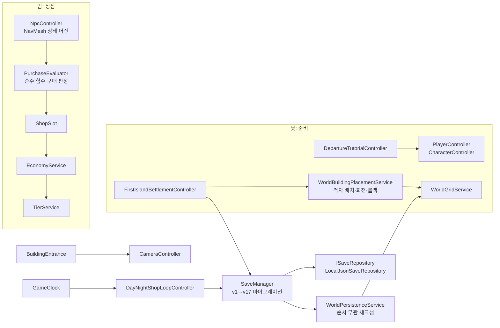

# Project P.A. (Pioneer Assistance)

낮에는 섬에서 자원을 모으고 거점을 세우고, 밤에는 직접 연 가게에서 물건값을 정해 파는 **3D 코지 생활·상점 경영 시뮬레이션**입니다.
Unity 6와 C#으로 혼자 만들고 있는 졸업작품이며(2026.01~), 손님 NPC는 성격에 따라 내가 매긴 가격을 보고 살지 말지를 스스로 판단합니다.

  

> **어느 브랜치를 봐야 하나요?** 기본 브랜치 `master`는 2026-08-06 기준 체크포인트입니다. 이 문서의 화면과 코드 링크는 최신 작업 브랜치 [`milestone/gameplay-beta-85`](https://github.com/junido7185/Project_PA/tree/milestone/gameplay-beta-85)의 커밋 [`b121140`](https://github.com/junido7185/Project_PA/tree/b121140ae6f5ca0f92078db5c2f75512dc8fc95a)(2026-10-06)을 기준으로 합니다.
> 모든 화면은 Unity Editor Play Mode에서 검증 스크립트가 찍은 실제 게임 화면입니다. `Docs/01_GAME_DESIGN/Art/TARGET_*.png`는 AI로 만든 아트 방향 참고 이미지라 여기에 쓰지 않았습니다.

## 지금 플레이할 수 있는 흐름

| 1. 판매 교육: 가격 정하기 | 2. 손님이 가격을 보고 구매 | 3. 함께 갈 동료 2명 선택 |
|---|---|---|
|  |  |  |
| **4. 배를 타고 섬으로** | **5. 격자 위에 거점 배치(R로 회전)** | **6. 정착 후 첫 영업 준비** |
|  |  |  |

밤 영업에서는 손님이 진열 상품과 가격을 보고 구매 여부를 정하고, 휴대폰 감사 앱에서 누적 매출과 다음 Tier 목표를 확인합니다. 아래 두 장은 2026-08-25 감사 때 Game View가 세로로 좁게 잡힌 상태에서 찍혀 일부만 잘라 실었습니다.

| 구매 판정이 화면에 보이는 순간 | 휴대폰 감사 앱 |
|---|---|
|  |  |

## 한눈에 보기

| 항목 | 내용 |
|---|---|
| 형태 | 개인 졸업작품, 1인 개발 (기획·시스템 설계·구현·통합·검증) |
| 엔진 | Unity 6 (6000.3.2f1), URP, C#, New Input System, AI Navigation(NavMesh) |
| 규모 | 런타임 C# 169개 파일 약 59,500줄, 에디터 도구·검증기 98개 파일 약 41,000줄 (milestone 기준) |
| 진입 | `Assets/Scenes/Prototype_FirstDay.unity` → NEW GAME → 출항 교육 → 섬 |
| 개발 방식 | AI 코딩 에이전트(Codex, Claude Code)를 구현에 사용. 아래 [개발 방식](#개발-방식과-제-역할)에 역할을 나눠 적었습니다 |

## 구조

## 기술적으로 설명할 수 있는 것

### 1. 성격에 따라 달라지는 결정론적 구매 판정
[`PurchaseEvaluator.cs#L22-L134`](https://github.com/junido7185/Project_PA/blob/b121140ae6f5ca0f92078db5c2f75512dc8fc95a/Assets/Scripts/PurchaseEvaluator.cs#L22-L134)

- 품질을 반영한 적정가 대비 판매가 비율을 S자 곡선으로 기본 구매 확률(싸면 95%, 적정가 70%, 1.5배 이상이면 5%)로 바꿉니다.
- 손님 프로필의 MBTI 축 세 가지를 수식에 넣습니다. S/N은 상품 분류(생활용품·사치품·가공품·원자재) 선호, T/F는 선호 증폭과 가격 민감도, E/I는 충동구매 보정입니다. J/P 축은 구매가 아니라 NPC 일과(`NpcScheduleController`)에 씁니다.
- `UnityEngine.Random`을 쓰지 않고 호출자가 넘긴 `System.Random`만 사용하는 순수 정적 함수입니다. NPC마다 이름으로 시드를 정해([`NpcController.cs#L104`](https://github.com/junido7185/Project_PA/blob/b121140ae6f5ca0f92078db5c2f75512dc8fc95a/Assets/Scripts/NpcController.cs#L104)) 같은 상황이면 같은 결과가 나오고, 검증기는 고정 시드로 판정을 재현합니다.
- 위 "가격 적정, 구매 (69%)" 말풍선이 이 함수의 결과가 화면에 나온 모습입니다.

### 2. 실내외 이동 때 위치가 되돌아가고 카메라가 길게 쓸려 가던 문제
[`BuildingEntrance.cs#L81-L111`](https://github.com/junido7185/Project_PA/blob/b121140ae6f5ca0f92078db5c2f75512dc8fc95a/Assets/Scripts/BuildingEntrance.cs#L81-L111) · [`CameraController.cs#L83-L87`](https://github.com/junido7185/Project_PA/blob/b121140ae6f5ca0f92078db5c2f75512dc8fc95a/Assets/Scripts/CameraController.cs#L83-L87)

실내를 별도 씬으로 나누면 NavMesh·시간·인벤토리·상점·저장 참조를 다시 연결해야 해서, 같은 씬 안의 분리된 공간으로 두고 문이 캐릭터를 옮기게 했습니다. 그러자 두 가지 문제가 생겼습니다.
- `CharacterController`가 켜진 상태로 위치를 바꾸면 내부에 쌓인 이동량이 다음 프레임에 위치를 덮어써 워프가 실패했습니다. → 컨트롤러를 끄고 옮긴 뒤 다시 켜고, 이동 속도 상태도 초기화합니다.
- 카메라가 Lerp로 따라오며 실내와 실외 사이를 한 번에 가로질렀습니다. → 워프 직후 `SnapToTarget()`으로 즉시 고정합니다.

이후 섬 월드가 생기면서 워프 목적지가 걸을 수 있는 칸인지 먼저 확인하는 단계(`WorldPlayerTraversalGuard.TryTeleportTo`)를 추가했습니다.

### 3. 저장 데이터 버전 관리와 "적용 전에 거절하기"
[`SaveManager.cs#L344-L381`](https://github.com/junido7185/Project_PA/blob/b121140ae6f5ca0f92078db5c2f75512dc8fc95a/Assets/Scripts/SaveManager.cs#L344-L381) · [`ISaveRepository.cs`](https://github.com/junido7185/Project_PA/blob/b121140ae6f5ca0f92078db5c2f75512dc8fc95a/Assets/Scripts/Services/ISaveRepository.cs)

- 저장 형식은 v17까지 올라왔고 `MigrateSaveData`가 v1부터 단계별로 변환합니다(L705~).
- 손상된 JSON, 더 새로운 버전, 현재 섬과 맞지 않는 저장은 **런타임 상태를 하나도 바꾸기 전에** 거절합니다(L367). 반쯤 불러온 상태로 게임이 이어지는 일을 막기 위해서입니다.
- 저장소는 `ISaveRepository` 비동기 인터페이스 뒤에 두었고, 검증기는 별도 폴더를 주입해 사용자 저장을 건드리지 않습니다.
- 섬 상태 체크섬은 타일·건물·가구·자원을 키 순서로 정렬한 뒤 계산해 저장 순서가 달라도 같은 값이 나옵니다([`WorldPersistenceService.cs#L248`](https://github.com/junido7185/Project_PA/blob/b121140ae6f5ca0f92078db5c2f75512dc8fc95a/Assets/Scripts/World/WorldPersistenceService.cs#L248)).

### 4. 회전 가능한 격자 배치와 실패 시 되돌리기
[`WorldBuildingPlacementService.cs#L381-L435`](https://github.com/junido7185/Project_PA/blob/b121140ae6f5ca0f92078db5c2f75512dc8fc95a/Assets/Scripts/World/WorldBuildingPlacementService.cs#L381-L435)

- 건물 점유 칸과 입구를 90° 단위로 회전해 계산하고, 범위 밖·물·길·경사·입구 막힘 등 실패 이유를 16가지로 구분해 돌려줍니다.
- 배치는 "판정 → 점유 칸 확정 → 생성" 순서이고, 생성 중 예외가 나면 점유 칸을 되돌립니다. 저장에서 복원하다 실패하면 직전 배치를 다시 적용합니다.

### 5. 카메라 거리를 수치로 고르기
화면 속 캐릭터 크기를 감으로 정하지 않고, 후보 거리 세 개에서 캐릭터 렌더러 경계를 화면에 투영해 높이 비율을 쟀습니다([`PA_OpeningFeelChecks.cs#L112-L117`](https://github.com/junido7185/Project_PA/blob/b121140ae6f5ca0f92078db5c2f75512dc8fc95a/Assets/Editor/PA_OpeningFeelChecks.cs#L112-L117), 결과 [`Camera-checks.txt`](https://github.com/junido7185/Project_PA/blob/b121140ae6f5ca0f92078db5c2f75512dc8fc95a/Docs/90_PRESENTATION/Evidence/2026-09-10/GameFeel/Camera-checks.txt)). 교육 구간과 섬에서 같은 비율(약 15.7%)이 나오도록 A안을 골랐습니다.

### 6. 실제 이동량으로 걷기·멈춤 애니메이션 전환
입력값이 아니라 실제로 움직인 거리로 속도를 계산해 애니메이터에 넘깁니다(`PlayerController.ActualPlanarSpeed`). 벽에 막히면 입력이 있어도 대기 자세로 바뀌고(검증 항목 "collision stop drives idle from actual velocity"), NPC는 `NavMeshAgent.velocity`를 씁니다.

| 플레이어 이동 (대기 → D → W → A → 대기) | NPC 이동 후 정지 |
|---|---|
|  |  |

두 GIF는 검증 스크립트가 실제 입력 이벤트를 넣고 100~200ms 이상 간격으로 찍은 프레임을 이어 붙인 것이라 실제 재생 속도와는 다릅니다.

## 검증 방법

- **에디터 검증기:** 메뉴로 실행하는 검증·리뷰 도구가 96개 있고, 그중 39개는 실행 메서드·전제 조건·실패 시 조치와 함께 [`validator-registry.json`](https://github.com/junido7185/Project_PA/blob/b121140ae6f5ca0f92078db5c2f75512dc8fc95a/Automation/LoopEngineering/validator-registry.json)에 등록했습니다. Play Mode에서 New Input System에 실제 키 입력을 넣고, 1920×1080 화면을 캡처하고, PASS/FAIL과 JSON 증거를 남깁니다.
- **증거 예시:** 출항 교육 [`P0-validation.json`](https://github.com/junido7185/Project_PA/blob/b121140ae6f5ca0f92078db5c2f75512dc8fc95a/Docs/90_PRESENTATION/Evidence/2026-09-08/P0-validation.json), 정착 [`P3-validation.json`](https://github.com/junido7185/Project_PA/blob/b121140ae6f5ca0f92078db5c2f75512dc8fc95a/Docs/90_PRESENTATION/Evidence/2026-09-09/P3/P3-validation.json), 저장 복원 [`Checkpoint-SaveRecovery-checks.txt`](https://github.com/junido7185/Project_PA/blob/b121140ae6f5ca0f92078db5c2f75512dc8fc95a/Docs/90_PRESENTATION/Evidence/2026-09-10/GameFeel/Checkpoint-SaveRecovery-checks.txt) ("load actually restores changed money").
- **NUnit 테스트:** 이어하기 호환성 테스트 2개뿐입니다. 대부분의 검증이 Play Mode 시나리오 검증기라 CI에서 돌지 않습니다.

## 아직 안 된 것

- Windows 단독 실행 빌드에서는 NEW GAME → 출항 교육 첫 단계까지만 직접 확인했습니다. 그 뒤 전체 경로는 Editor에서만 검증됐습니다.
- 마지막 다듬기 작업(D2)은 툴팁의 키 안내 오류(Space/E), 대화와 안내 문구 겹침이 남은 상태로 멈춰 있습니다.
- 섬 16×16 구역의 첫 생산 단계는 부분 구현이고, 섬에서 밤 상점으로 이어지는 흐름은 별도 데모 맵에서만 연결돼 있습니다.
- 시각 품질은 사람이 최종 확인하지 않았습니다. 캐릭터 발 접지와 양손 들기 자세가 어색합니다.
- 캐릭터·건물 일부는 AI 3D 생성 도구(Tripo)로 만든 에셋이며 라이선스 확인이 출시 전 과제로 남아 있습니다. 자연 에셋과 애니메이션은 Quaternius(CC0)입니다.

## 개발 방식과 제 역할

1인 프로젝트이며, 코드와 문서의 상당 부분은 **AI 코딩 에이전트(Codex, Claude Code)가 작성했습니다.** 커밋에 `Co-Authored-By` 표기가 남아 있습니다. 제가 맡은 일은 다음과 같습니다.

- **게임과 범위 정의:** 정체성 문서, 핵심 루프, 이번 데모 범위를 정하고 작업을 티켓 단위로 나눴습니다.
- **에이전트 운영 규칙:** 쓸 수 있는 경로와 보호 파일(기준 씬, 저장 스키마 등), 티켓당 시도 2회·변경 파일 15개 제한, 같은 원인으로 두 번 실패하면 멈추는 규칙, 씬·저장 형식·밸런스 변경 시 사람 승인 단계를 만들었습니다([`AGENTS.md`](https://github.com/junido7185/Project_PA/blob/b121140ae6f5ca0f92078db5c2f75512dc8fc95a/AGENTS.md), [`loop-policy.json`](https://github.com/junido7185/Project_PA/blob/b121140ae6f5ca0f92078db5c2f75512dc8fc95a/Automation/LoopEngineering/loop-policy.json)).
- **결정:** 예를 들어 v16 이하 저장은 변환하지 않고 원본을 보존한 채 안내만 하기로 정했고(`SaveManager.cs` L324 주석), 실내를 별도 씬 대신 같은 씬의 분리 공간으로 두기로 했습니다.
- **검증:** 생성된 코드는 컴파일, 기능별 검증기, Play Mode 경로 순서로 확인했고, UI 배치나 이동 감각처럼 자동 판정이 어려운 부분은 Game View에서 직접 봤습니다.

## 실행

1. Unity 6000.3.2f1로 저장소를 엽니다. `Packages/manifest.json`의 `com.coplaydev.unity-mcp`(에디터용 AI 연동 패키지)는 게임 실행에 필요하지 않아, 설치가 막히면 지워도 됩니다.
2. `Assets/Scenes/Prototype_FirstDay.unity`를 열고 Play → NEW GAME.
3. 조작: WASD 이동, 상호작용은 출항 교육에서 Space·섬에서 E(`PlayerInputHandler.cs` L154), 섬에서 Space 점프, R 건물 회전, F5 저장 / F9 불러오기.

이전 개발용 README는 [Docs/README_DEVELOPMENT_master.md](Docs/README_DEVELOPMENT_master.md)로 옮겼습니다.
