# Project P.A. (Pioneer Assistance)

낮에는 섬에서 자원을 모으고 거점을 세우고, 밤에는 직접 연 가게에서 물건값을 정해 파는 **3D 코지 생활·상점 경영 시뮬레이션**입니다.
Unity 6·C#으로 1인 개발 중인 졸업작품(2025.12 ~)입니다. 손님 NPC는 성격에 따라 플레이어가 정한 가격을 보고 구매 여부를 스스로 판단합니다.

  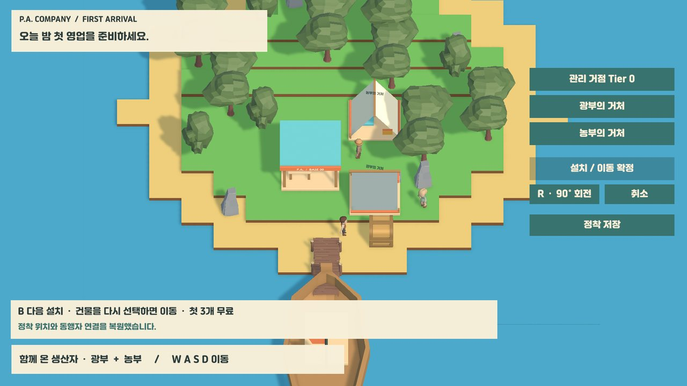

> 화면과 코드 링크는 기본 브랜치(`master`, 2026-08-06)가 아니라 최신 작업 브랜치 [`milestone/gameplay-beta-85`](https://github.com/junido7185/Project_PA/tree/milestone/gameplay-beta-85)의 커밋 [`b121140`](https://github.com/junido7185/Project_PA/tree/b121140ae6f5ca0f92078db5c2f75512dc8fc95a)(2026-10-06) 기준입니다.

## 지금 플레이할 수 있는 흐름

| 1. 판매 교육: 가격 정하기 | 2. 손님이 가격을 보고 구매 | 3. 함께 갈 동료 2명 선택 |
|---|---|---|
| 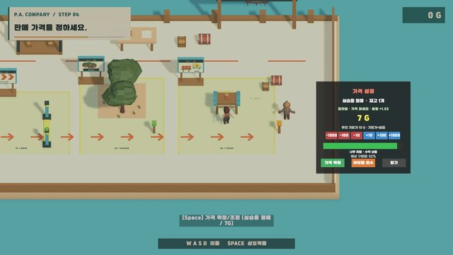 | 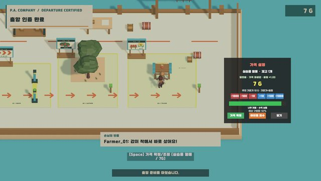 | 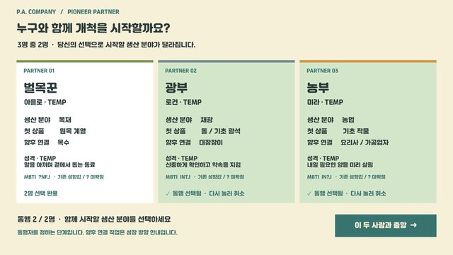 |
| **4. 배를 타고 섬으로** | **5. 격자 위에 거점 배치(R로 회전)** | **6. 정착 후 첫 영업 준비** |
| 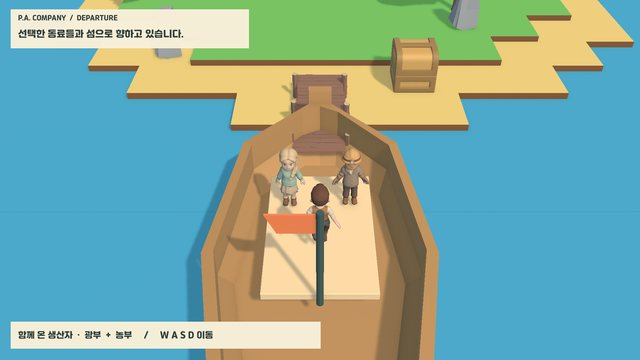 | 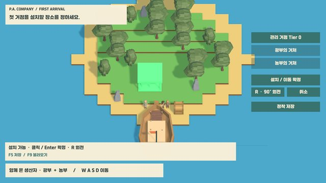 | 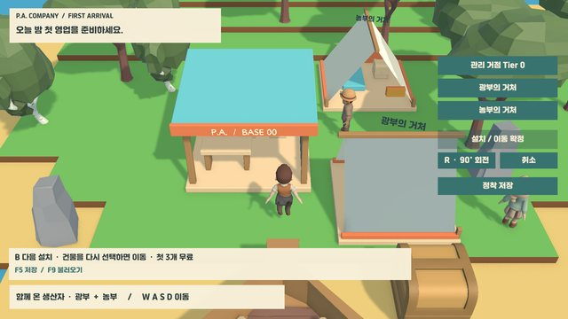 |

밤 영업에서는 손님이 진열 상품과 가격을 보고 구매 여부를 정하고, 휴대폰 등급 심사 앱에서 누적 매출과 다음 등급 목표를 확인합니다.

| 구매 판정이 화면에 보이는 순간 | 휴대폰 등급 심사 앱 |
|---|---|
| 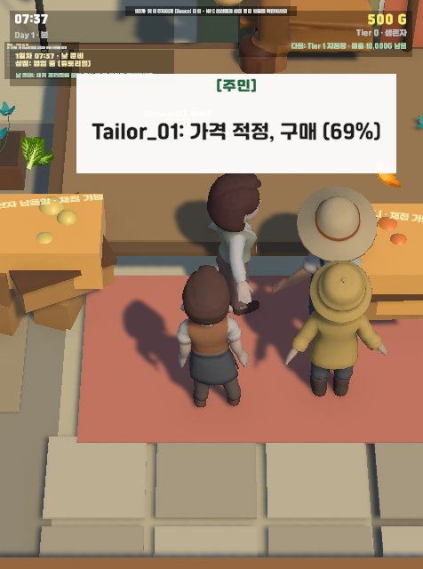 | 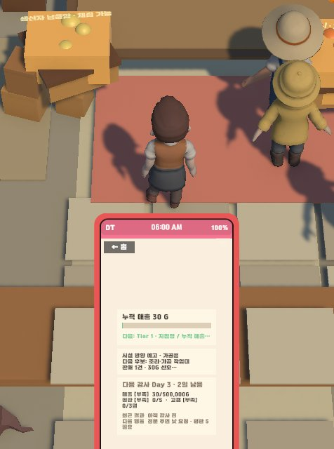 |

모든 화면은 Unity Editor Play Mode에서 검증 스크립트가 찍은 실제 게임 화면입니다. `Docs/01_GAME_DESIGN/Art/TARGET_*.png`는 AI로 만든 아트 방향 참고 이미지라 여기에 쓰지 않았습니다.

## 한눈에 보기

| 항목 | 내용 |
|---|---|
| 형태 | 개인 졸업작품, 1인 개발 (기획·설계·AI 에이전트 작업 지휘·통합·검증) |
| 엔진 | Unity 6 (6000.3.2f1), URP, C#, New Input System, AI Navigation(NavMesh) |
| 규모 | 런타임 C# 169개 파일, 메뉴로 실행하는 검증기 96개 |
| 진입 | `Assets/Scenes/Prototype_FirstDay.unity` → NEW GAME → 출항 교육 → 섬 |
| 개발 방식 | AI 코딩 에이전트(Codex, Claude Code)로 구현. 자세한 내용은 [개발 방식](#개발-방식) |

## 구조

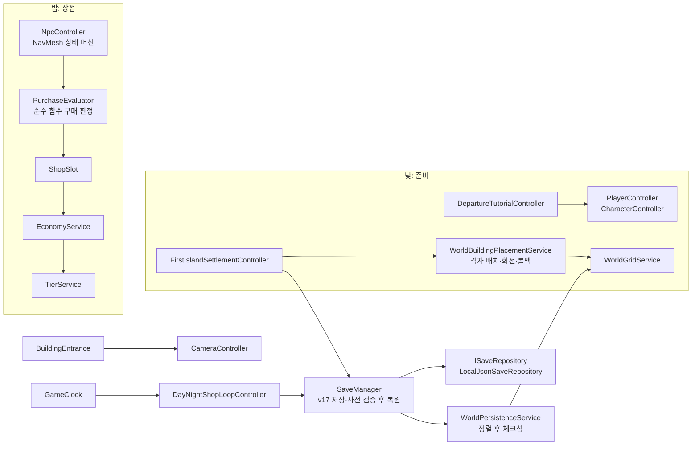

## 핵심 구현

### 1. 성격에 따라 달라지는 구매 판정
[`PurchaseEvaluator.cs#L22-L134`](https://github.com/junido7185/Project_PA/blob/b121140ae6f5ca0f92078db5c2f75512dc8fc95a/Assets/Scripts/PurchaseEvaluator.cs#L22-L134)

- 품질을 반영한 적정가 대비 판매가 비율을 구간 선형 곡선으로 기본 구매 확률로 바꿉니다: ≤0.7배 95%, 1.0배 70%, 1.5배 10%, 초과 시 5%([`L60-L69`](https://github.com/junido7185/Project_PA/blob/b121140ae6f5ca0f92078db5c2f75512dc8fc95a/Assets/Scripts/PurchaseEvaluator.cs#L60-L69)).
- 손님 프로필의 MBTI 축 세 가지를 수식에 넣습니다. S/N은 상품 분류(생활용품·사치품·가공품·원자재) 선호, T/F는 선호 증폭과 가격 민감도, E/I는 충동구매 보정입니다. J/P 축은 구매가 아니라 NPC 일과(`NpcScheduleController`)에 씁니다.
- `UnityEngine.Random`을 쓰지 않고 호출자가 넘긴 `System.Random`만 쓰는 정적 함수라, 검증기에서 고정 시드를 넣으면 판정을 재현할 수 있습니다. 게임 안의 NPC는 이름 문자열의 `GetHashCode()`로 시드를 정하고([`NpcController.cs#L101-L104`](https://github.com/junido7185/Project_PA/blob/b121140ae6f5ca0f92078db5c2f75512dc8fc95a/Assets/Scripts/NpcController.cs#L101-L104)) RNG가 NPC마다 상태를 이어 가므로, 실행 환경이나 호출 순서가 달라도 같은 결과가 나온다고 보장하지는 않습니다.
- 위 "가격 적정, 구매 (69%)" 말풍선이 이 함수의 결과가 화면에 나온 모습입니다.

### 2. 실내외 이동 때 위치가 되돌아가고 카메라가 길게 쓸려 가던 문제
[`BuildingEntrance.cs#L81-L111`](https://github.com/junido7185/Project_PA/blob/b121140ae6f5ca0f92078db5c2f75512dc8fc95a/Assets/Scripts/BuildingEntrance.cs#L81-L111) · [`CameraController.cs#L83-L87`](https://github.com/junido7185/Project_PA/blob/b121140ae6f5ca0f92078db5c2f75512dc8fc95a/Assets/Scripts/CameraController.cs#L83-L87)

실내를 별도 씬으로 나누면 NavMesh·시간·인벤토리·상점·저장 참조를 다시 연결해야 해서, 같은 씬 안의 분리된 공간으로 두고 문이 캐릭터를 옮기게 했습니다. 그러자 두 가지 문제가 생겼습니다.
- `CharacterController`가 켜진 상태로 위치를 바꾸면 내부에 쌓인 이동량이 다음 프레임에 위치를 덮어써 워프가 실패했습니다. → 컨트롤러를 끄고 옮긴 뒤 다시 켜고, 이동 속도 상태도 초기화합니다.
- 카메라가 Lerp로 따라오며 실내와 실외 사이를 한 번에 가로질렀습니다. → 워프 직후 `SnapToTarget()`으로 즉시 고정합니다.

이후 섬 월드가 생기면서 워프 목적지가 걸을 수 있는 칸인지 먼저 확인하는 단계(`WorldPlayerTraversalGuard.TryTeleportTo`)를 추가했습니다.

### 3. 저장 데이터 버전 관리와 "적용 전에 거절하기"(부분 구현)
[`SaveManager.cs#L344-L440`](https://github.com/junido7185/Project_PA/blob/b121140ae6f5ca0f92078db5c2f75512dc8fc95a/Assets/Scripts/SaveManager.cs#L344-L440) · [`ISaveRepository.cs`](https://github.com/junido7185/Project_PA/blob/b121140ae6f5ca0f92078db5c2f75512dc8fc95a/Assets/Scripts/Services/ISaveRepository.cs)

- 저장 형식은 v17입니다. `MigrateSaveData`(L705~)가 v0부터 단계별로 변환하지만, 이 변환은 FirstDay 섬이 아닌 씬에서만 탑니다(L377-L382). FirstDay 섬에서는 v16 이하 저장을 변환하지 않고 원본을 둔 채 거절합니다(L368-L369).
- 손상 JSON·상위 버전·v16 이하·섬 준비 미완료는 런타임을 건드리기 전에 거절합니다(L347-L375). 다만 L403의 `PrepareRuntimeForStateRestore()` 이후 월드·배치 복원 단계(L417·L428·L438·L440)의 실패는 오류만 기록하고 아직 롤백하지 않아, 트랜잭션형 로드로 바꾸는 것이 다음 과제입니다.
- 저장소는 `ISaveRepository` 비동기 인터페이스 뒤에 두었고, 검증기는 별도 폴더를 주입해 사용자 저장을 건드리지 않습니다.
- 섬 상태 체크섬은 타일·건물·가구·자원 목록을 키로 정렬한 뒤 계산해, 이 목록들의 저장 순서에는 영향을 받지 않습니다([`WorldPersistenceService.cs#L248-L303`](https://github.com/junido7185/Project_PA/blob/b121140ae6f5ca0f92078db5c2f75512dc8fc95a/Assets/Scripts/World/WorldPersistenceService.cs#L248-L303)). 다만 문자열 키를 LINQ `OrderBy` 기본 비교(문화권 영향)로 정렬하고 건물 내부 보관 아이템(`storedItems`)은 정렬하지 않아, 완전한 순서 무관은 아닙니다.

### 4. 회전 가능한 격자 배치와 실패 시 되돌리기
[`WorldBuildingPlacementService.cs#L381-L435`](https://github.com/junido7185/Project_PA/blob/b121140ae6f5ca0f92078db5c2f75512dc8fc95a/Assets/Scripts/World/WorldBuildingPlacementService.cs#L381-L435)

- 건물 점유 칸과 입구를 90° 단위로 회전해 계산하고, 범위 밖·물·길·경사·입구 막힘 등 실패 이유를 20가지로 구분해 돌려줍니다(`WorldBuildingPlacementFailure`, L14-L36).
- 배치는 "판정 → 점유 칸 확정 → 생성" 순서이고, 생성 중 예외가 나면 점유 칸을 되돌립니다. 첫 정착 배치를 저장에서 복원하다 예외가 나면 직전 배치를 다시 적용합니다([`FirstIslandSettlementController.cs#L266-L284`](https://github.com/junido7185/Project_PA/blob/b121140ae6f5ca0f92078db5c2f75512dc8fc95a/Assets/Scripts/Presentation/FirstIslandSettlementController.cs#L266-L284)).

### 5. 카메라 거리를 수치로 고르기
화면 속 캐릭터 크기를 감으로 정하지 않고, 후보 거리 세 개에서 캐릭터 렌더러 경계를 화면에 투영해 높이 비율을 쟀습니다([`PA_OpeningFeelChecks.cs#L112-L117`](https://github.com/junido7185/Project_PA/blob/b121140ae6f5ca0f92078db5c2f75512dc8fc95a/Assets/Editor/PA_OpeningFeelChecks.cs#L112-L117), 결과 [`Camera-checks.txt`](https://github.com/junido7185/Project_PA/blob/b121140ae6f5ca0f92078db5c2f75512dc8fc95a/Docs/90_PRESENTATION/Evidence/2026-09-10/GameFeel/Camera-checks.txt)). A안(16.4%)을 고른 뒤 최종 카메라에서 15.7%로 맞췄습니다([`Flow-checks.txt`](https://github.com/junido7185/Project_PA/blob/b121140ae6f5ca0f92078db5c2f75512dc8fc95a/Docs/90_PRESENTATION/Evidence/2026-09-10/GameFeel/Flow-checks.txt) 첫 줄).

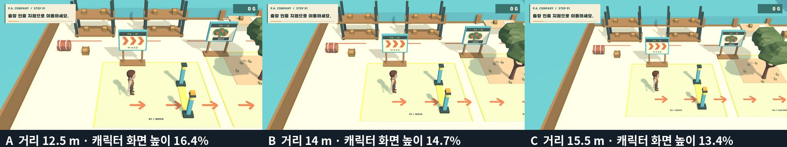

### 6. 실제 이동량으로 걷기·멈춤 애니메이션 전환
입력값이 아니라 실제로 움직인 거리로 속도를 계산해 애니메이터에 넘깁니다(`PlayerController.ActualPlanarSpeed`). 벽에 막히면 입력이 있어도 대기 자세로 바뀌고(검증 항목 "collision stop drives idle from actual velocity"), NPC는 `NavMeshAgent.velocity`를 씁니다.

| 플레이어 이동 (대기 → D → W → A → 대기) | NPC 이동 후 정지 |
|---|---|
| 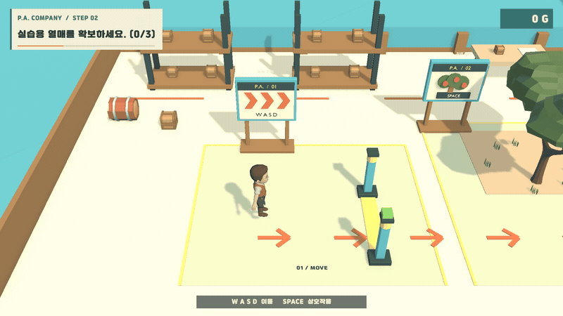 | 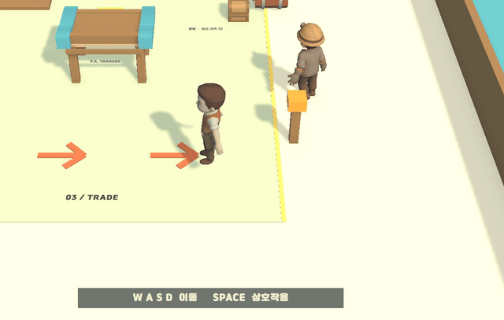 |

두 GIF는 검증 스크립트가 실제 입력 이벤트를 넣으며 100~200ms 간격으로 찍은 프레임을, 포트폴리오 정리 중(2026-10-13) Claude Code로 이어 붙인 것이라 실제 재생 속도와 다릅니다.

## 검증 방법

- **에디터 검증기:** 메뉴로 실행하는 검증·리뷰 도구가 96개 있고, 그중 39개는 실행 메서드·전제 조건·실패 시 조치와 함께 [`validator-registry.json`](https://github.com/junido7185/Project_PA/blob/b121140ae6f5ca0f92078db5c2f75512dc8fc95a/Automation/LoopEngineering/validator-registry.json)에 등록했습니다. Play Mode에서 New Input System에 실제 키 입력을 넣고, 1920×1080 화면을 캡처하고, PASS/FAIL과 JSON 증거를 남깁니다.
- **증거 예시:** 출항 교육 [`P0-validation.json`](https://github.com/junido7185/Project_PA/blob/b121140ae6f5ca0f92078db5c2f75512dc8fc95a/Docs/90_PRESENTATION/Evidence/2026-09-08/P0-validation.json), 정착 [`P3-validation.json`](https://github.com/junido7185/Project_PA/blob/b121140ae6f5ca0f92078db5c2f75512dc8fc95a/Docs/90_PRESENTATION/Evidence/2026-09-09/P3/P3-validation.json), 저장 복원 [`Checkpoint-SaveRecovery-checks.txt`](https://github.com/junido7185/Project_PA/blob/b121140ae6f5ca0f92078db5c2f75512dc8fc95a/Docs/90_PRESENTATION/Evidence/2026-09-10/GameFeel/Checkpoint-SaveRecovery-checks.txt) ("load actually restores changed money").
- **NUnit 테스트:** 이어하기 호환성 테스트 2개뿐입니다. 대부분의 검증이 Play Mode 시나리오 검증기라 CI에서 돌지 않습니다.

## 아직 안 된 것

- Windows 단독 실행 빌드(2026-09-27 후보)는 에이전트 자동 입력으로 NEW GAME → 출항 교육 첫 단계까지만 확인했습니다. 같은 빌드로 엔딩까지 직접 플레이했다는 기록은 있지만 캡처 증거는 없고, 이후 경로의 자동 검증은 Editor에서만 했습니다.
- 마지막 다듬기 작업(D2)은 툴팁의 키 안내 오류(Space/E), 대화와 안내 문구 겹침이 남은 상태로 멈춰 있습니다.
- 섬 16×16 구역의 첫 생산 단계는 부분 구현이고, 섬에서 밤 상점으로 이어지는 흐름은 별도 데모 맵에서만 연결돼 있습니다.
- 시각 품질은 사람이 최종 확인하지 않았습니다. 캐릭터 발 접지와 양손 들기 자세가 어색합니다.
- 캐릭터·건물 일부는 AI 3D 생성 도구(Tripo)로 만든 에셋이며 라이선스 확인이 출시 전 과제로 남아 있습니다. 자연 에셋과 애니메이션은 Quaternius(CC0)입니다.

## 개발 방식

구현에는 AI 코딩 에이전트(Codex, Claude Code)를 사용했고, 코드와 문서의 상당 부분을 에이전트가 작성했습니다. 저는 게임 정체성·핵심 루프·데모 범위와 작업 티켓을 정하고, 에이전트 운영 규칙과 검증 기준을 만든 뒤, 결과를 컴파일·기능별 검증기·Play Mode 경로·Game View 확인으로 점검해 통합했습니다.

- 운영 규칙: 쓸 수 있는 경로와 보호 파일(기준 씬, 저장 스키마 등), 티켓당 시도 2회·변경 파일 15개 제한, 같은 원인으로 두 번 실패하면 멈추는 규칙, 씬·저장 형식·밸런스 변경 시 사람 승인 단계([`AGENTS.md`](https://github.com/junido7185/Project_PA/blob/b121140ae6f5ca0f92078db5c2f75512dc8fc95a/AGENTS.md), [`loop-policy.json`](https://github.com/junido7185/Project_PA/blob/b121140ae6f5ca0f92078db5c2f75512dc8fc95a/Automation/LoopEngineering/loop-policy.json)).
- 결정 예시: FirstDay 섬에서 v16 이하 저장은 변환하지 않고 원본을 보존한 채 사유만 안내하기로 했고(`SaveManager.cs` L324 주석), 실내를 별도 씬 대신 같은 씬의 분리 공간으로 두기로 했습니다.
- 기록: `milestone/gameplay-beta-85`의 커밋 98개 중 12개(2026-07-09 ~ 2026-07-13)에 AI 공동 작성(`Co-Authored-By`) 표기가 있습니다.

## 실행

0. `git checkout milestone/gameplay-beta-85`
1. Unity 6000.3.2f1로 저장소를 엽니다. `Packages/manifest.json`의 `com.coplaydev.unity-mcp`(에디터용 AI 연동 패키지)는 게임 실행에 필요하지 않아, 설치가 막히면 지워도 됩니다.
2. `Assets/Scenes/Prototype_FirstDay.unity`를 열고 Play → NEW GAME.
3. 조작: WASD 이동, 상호작용은 출항 교육에서 Space·섬에서 E(`PlayerInputHandler.cs` L154), 섬에서 Space 점프, R 건물 회전, F5 저장 / F9 불러오기.

이전 개발용 README는 [Docs/README_DEVELOPMENT_master.md](Docs/README_DEVELOPMENT_master.md)로 옮겼습니다.
