# Project P.A.

**낮에는 섬을 가꾸고, 밤에는 그 섬의 잡화점 주인이 됩니다.**

<p align="center">
  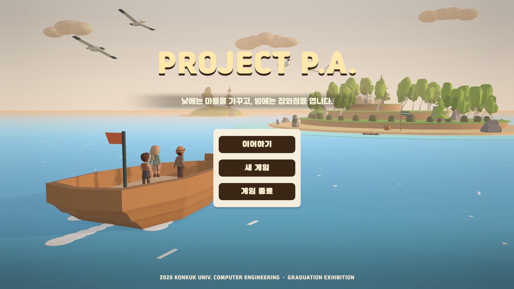
</p>

Project P.A.(Pioneer Assistance)는 섬 생활과 상점 경영을 엮은 3D 게임입니다. 낮에 주운 조개, 직접 낚은 물고기, 작업대에서 만든 물건을 저녁 가게에 내놓습니다. 무엇을 팔지, 얼마를 받을지 정하는 것도 플레이어의 몫입니다.

약 1년 동안 만든 개인 졸업작품입니다. 낮에 했던 일이 밤의 가게에 남고, 가게를 운영하는 일이 다시 주민과 마을의 생활로 이어지는 게임을 목표로 개발하고 있습니다.

| 개발 | 엔진·언어 | 현재 버전 |
| --- | --- | --- |
| 1인 개발 · 2025년 말부터 | Unity 6 · C# · URP | Windows 첫날 데모 · 2026.11.09 기준 |

[플레이 내용](#섬에서-보내는-하루) · [구현 이야기](#화면-뒤에서-돌아가는-것들) · [실행 방법](#실행하기) · [개발 기록](Docs/04_DEVELOPMENT_LOG/README.md)

## 섬에서 보내는 하루

출항 전 짧은 판매 교육을 받고, 세 명의 후보 중 함께 갈 동료 두 명을 고릅니다. 배가 섬에 닿으면 보급품을 챙기고 가게와 동료의 텐트를 놓습니다. 그 뒤부터는 섬을 돌아다니며 첫 영업을 준비합니다.

| 아침, 가게와 동료의 거처를 세운 뒤 | 밤, 불을 켜고 손님을 맞는 가게 |
| --- | --- |
| 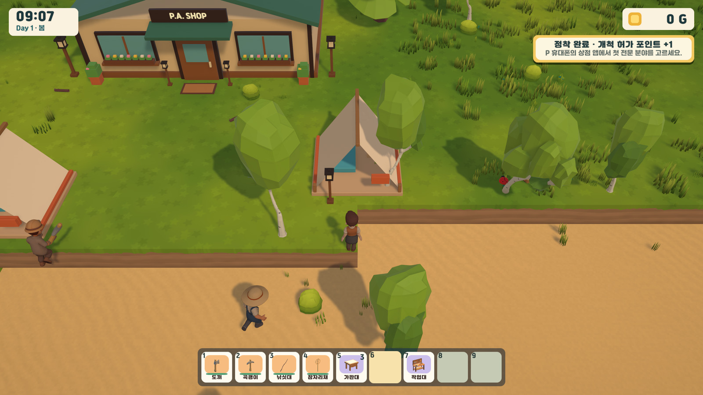 | 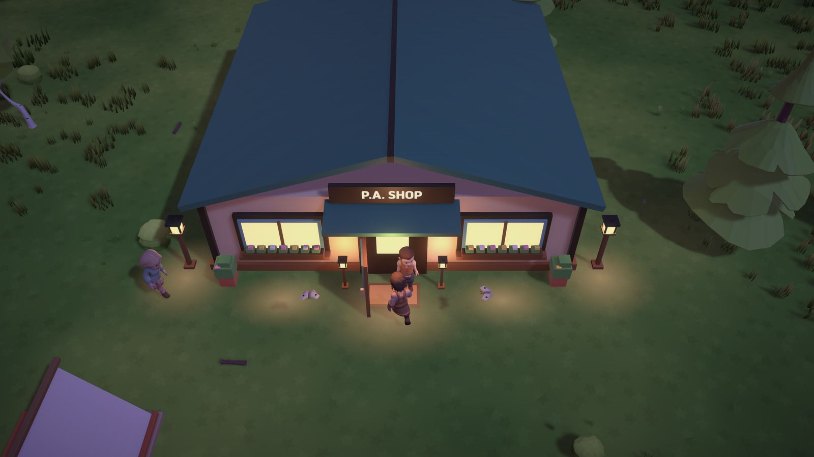 |

나무와 광석을 모으거나 낚시를 하고, 해변을 걷다가 작은 발견물을 줍기도 합니다. 모은 재료는 그대로 팔아도 되고 요리나 공예품으로 만들어도 됩니다. 해가 지면 진열대에 물건을 올리고 가격을 정한 뒤, 휴대폰의 상점 앱으로 문을 엽니다. 손님은 상품과 가격을 살펴보고 구매하거나 돌아갑니다. 영업이 끝나면 매출과 첫날의 활동을 보고서로 확인합니다.

첫 정착부터 첫 영업까지는 약 5분의 시연 동선으로 묶었습니다. 낚시와 곤충 채집, 꾸미기는 그 사이에 골라 즐기는 활동입니다.

## 같은 섬에서도 찾는 곳과 시간이 다릅니다

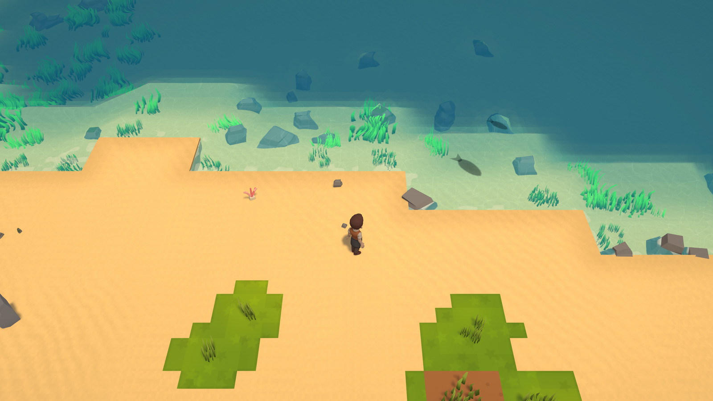

바다에는 물고기 그림자가 다니고, 꽃 위나 나무 밑동에는 곤충이 머뭅니다. 생물을 추가할 때는 생김새와 함께 발견하는 장소와 잡는 방법도 다르게 만들었습니다.

| 발견할 것 | 게임 안에서의 행동 |
| --- | --- |
| 정어리·고등어·넙치 | 정어리는 무리로 다니고, 고등어는 빠르게 방향을 틀며, 넙치는 오래 멈춰 쉽니다. |
| 송어·장어·붕어 | 강, 하구, 고지대 연못으로 서식 구역을 나눴습니다. 출현 시간도 다릅니다. |
| 장수풍뎅이·호박벌·방아깨비 | 나무 밑동에 붙어 있거나 꽃 사이를 날고, 땅에서 폴짝 뜁니다. 날거나 뛰는 동안에는 내려앉기를 기다려야 합니다. |
| 왕귀뚜라미·애반딧불이 | 해 질 녘의 울음과 풀 떨림, 밤 강가의 깜빡이는 빛으로 찾습니다. |

| 물가에서 입질을 기다리는 중 | 찾은 생물은 휴대폰 도감에 기록 |
| --- | --- |
| 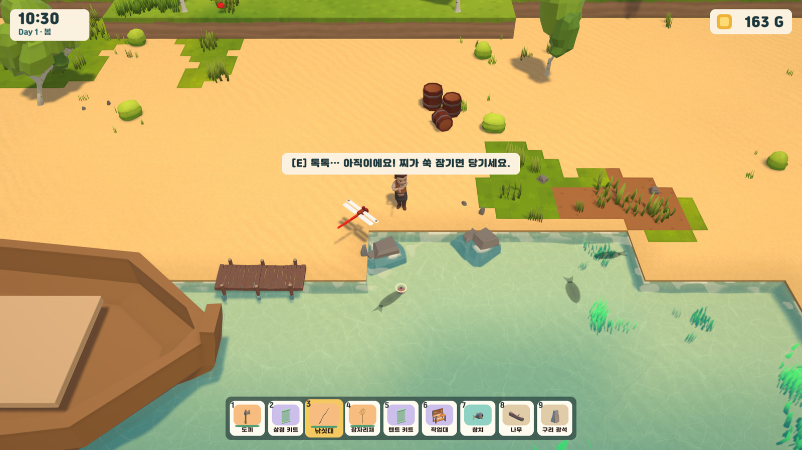 | 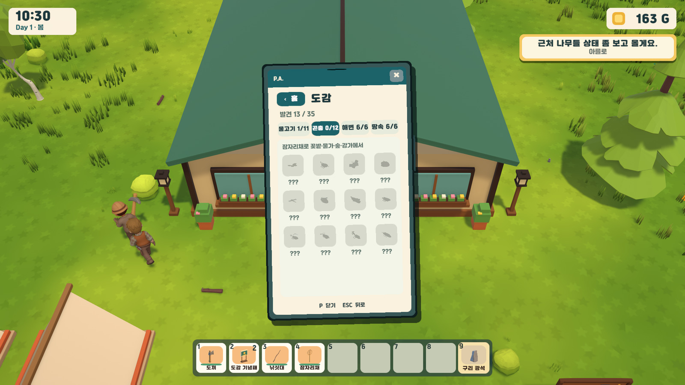 |

현재 도감에는 **물고기 11종, 곤충 12종, 해변 발견물 6종, 땅속 발견물 6종으로 총 35종**이 들어 있습니다. 아직 못 찾은 것은 실루엣과 서식지 힌트로 남고, 발견한 것은 이름과 설명, 판매·제작·선물·소장 쓰임을 확인할 수 있습니다. 한 분야를 채우면 가게에 놓을 기념패를 받습니다.

## 주운 물건이 저녁의 상품이 되기까지

재료마다 쓰임이 겹치도록 만들었습니다. 구리 주괴를 도구에 쓸 수도 있지만, 해변 유리와 엮어 펜던트를 만들 수도 있습니다. 생선은 그대로 진열하거나 조리대에서 요리하고, 해변에서 모은 조개는 목걸이와 장식의 재료가 됩니다.

| 조리대에서 재료와 결과를 확인 | 진열한 물건의 가격은 직접 결정 |
| --- | --- |
| 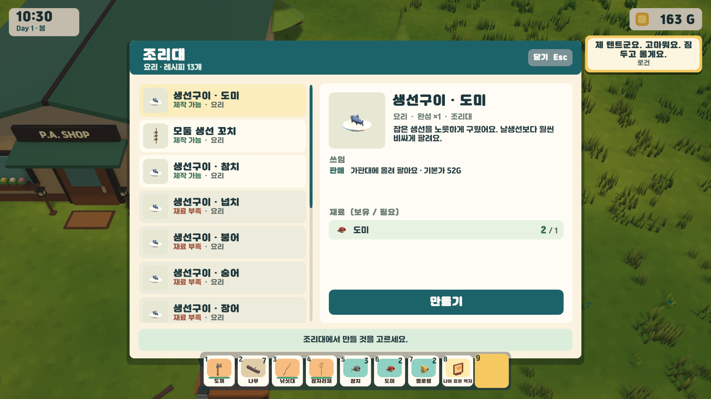 | 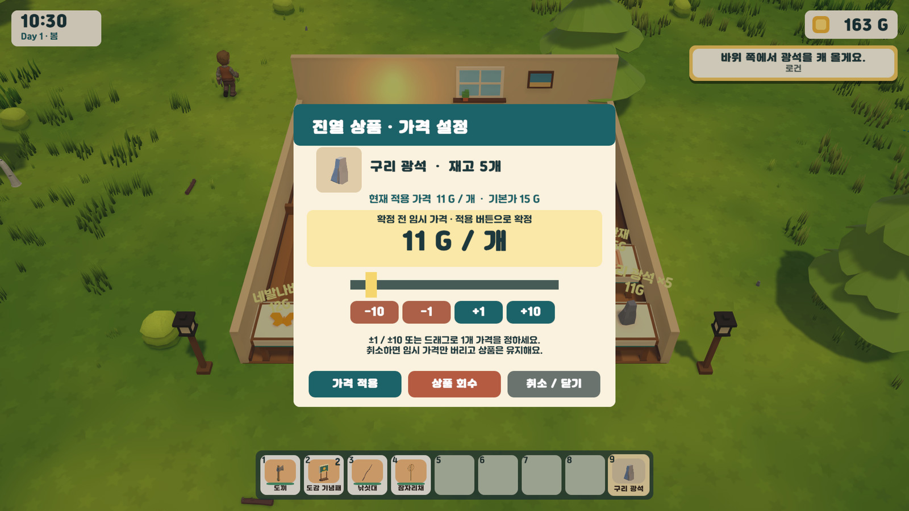 |

손님마다 좋아하는 상품 분류와 가격 민감도가 다릅니다. 같은 물건도 손님에 따라 반응이 달라집니다. 물건이 팔리면 진열 수량이 줄고 소지금이 늘며, 판매 기록과 영업 보고서에도 같은 거래를 남깁니다.

```text
해변 유리 + 구리 주괴 → 펜던트 제작 → 진열·가격 설정 → 손님의 구매 판단 → 매출·보고서
```

현장 작업대, 조리대, 용광로는 각각 가공·공예, 요리, 제련을 맡습니다. 광업 전문 분야에서는 개선한 도구를 광부에게 건네 생산을 도울 수도 있습니다.

## 가게에도, 동료에게도 생활이 남도록

상품을 늘리는 것과 함께 가게 안에서 지내는 모습도 다듬었습니다. 나무 의자를 산호빛이나 바다빛으로 칠하고, 러그를 바꾸고, 도감 기념패를 벽에 겁니다. 해변이나 땅속에서 찾은 작은 물건은 책상 위에 올려 둘 수 있습니다. 손님은 의자에 앉아 쉬거나 놓인 장식을 알아보고 말을 건넵니다.

| 판매 공간과 생활 공간이 함께 있는 가게 | 좋아하는 선물을 받은 동료의 반응 |
| --- | --- |
| 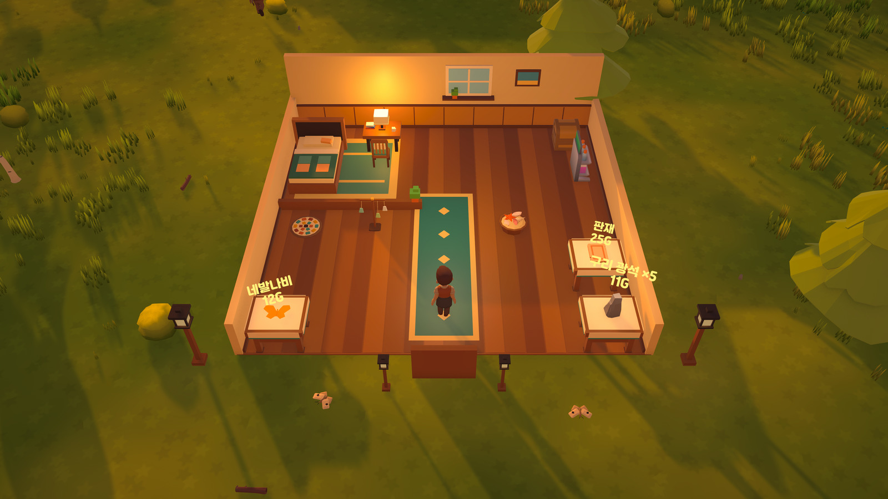 | 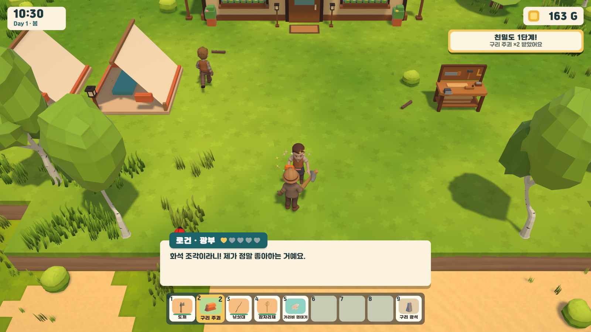 |

함께 온 동료에게는 이름과 역할, 선물 취향이 있습니다. 낮과 밤, 들고 있는 물건과 주변 상황에 따라 대사가 바뀌고, 저녁에는 모여 이야기를 나누거나 가게를 찾습니다. 가게 문은 사람이 가까이 오면 열리고, 손님은 문을 거쳐 드나듭니다. 실내에 들어가면 지붕과 앞벽을 걷어 내부가 보이게 했습니다.

## 화면 뒤에서 돌아가는 것들

기능 하나를 붙인 뒤에도 다른 기능과 이어지는 구간을 계속 손봤습니다. 건물을 옮긴 뒤 손님이 들어오는지, 물건이 팔린 뒤 기록이 맞는지, 저장하고 다시 열어도 같은 상태인지까지 확인하는 과정이 개발의 큰 부분이었습니다.

| 구현 | 신경 쓴 부분 | 코드 |
| --- | --- | --- |
| 섬 지형과 물가 | 격자 월드를 청크 메시로 만들고 지표·절벽·수면을 구분합니다. 해안 식생과 물속 바위로 물가의 깊이를 표현했습니다. | [WorldChunkTerrain](Assets/Scripts/World/WorldChunkTerrain.cs), [CoastalVegetationField](Assets/Scripts/Presentation/CoastalVegetationField.cs) |
| 건물·가구 배치 | 회전한 점유 칸과 입구를 검사하고, 불가능한 위치는 미리 알려 줍니다. 생성에 실패하면 점유 상태를 되돌립니다. | [WorldBuildingPlacementService](Assets/Scripts/World/WorldBuildingPlacementService.cs), [WorldHotbarPlacementController](Assets/Scripts/World/WorldHotbarPlacementController.cs) |
| 손님의 구매 | 적정가 대비 판매가, 상품 분류 선호, 가격 민감도와 성격을 계산합니다. 외부에서 난수 생성기를 받아 판정을 검증할 수 있게 했습니다. | [PurchaseEvaluator](Assets/Scripts/PurchaseEvaluator.cs) |
| 실내외 이동 | 캐릭터 이동 컨트롤러를 처리한 뒤 위치를 옮기고, 카메라를 즉시 맞춰 먼 공간 사이로 화면이 쓸려 가는 현상을 막았습니다. | [BuildingEntrance](Assets/Scripts/BuildingEntrance.cs), [CameraController](Assets/Scripts/CameraController.cs) |
| 저장과 이어하기 | 현재 v17 형식의 진행·배치·수집 기록을 복원합니다. 현재 섬과 호환되지 않는 v16 이하 저장은 사유를 안내하고 원본을 보존합니다. 검증에는 별도 저장 경로를 씁니다. | [SaveManager](Assets/Scripts/SaveManager.cs), [WorldPersistenceService](Assets/Scripts/World/WorldPersistenceService.cs) |
| 생물과 도감 | 종류별 행동은 기존 포획 흐름으로 연결하고, 도감은 가방에서 처음 획득한 항목을 기록합니다. 같은 날 잡은 곤충이 이어하기로 다시 생기지 않도록 포획 기록도 저장합니다. | [BugCritter](Assets/Scripts/BugCritter.cs), [DiscoveryLog](Assets/Scripts/World/DiscoveryLog.cs) |

### 실행해서 확인하는 과정

Windows 실행 파일에 시나리오별로 입력을 넣고 화면을 찍는 도구를 만들었습니다. 2026년 11월 9일 기준 출항·정착·제작·영업·생물·꾸밈을 포함한 **42개 시나리오가 모두 통과했고, 기록된 오류와 예외는 0건**입니다. [결과 원문](Docs/Portfolio/2026-11/verification-summary.txt) · [캡처 도구 코드](Assets/Scripts/Presentation/ExhibitionCaptureDirector.cs)

새 게임에서 첫 영업 보고서까지 한 세션으로 확인한 관람객 동선은 약 4분 20초였습니다. 자동 시나리오는 위치·재료·시간 등을 설정하기도 하며, 직접 조작했을 때의 손맛이나 전체 게임 완성을 보증하지는 않습니다. 낚시 릴 감각과 캐릭터 모션은 계속 다듬을 부분입니다.

<details>
<summary>영업 보고서와 제작 설비 화면</summary>

| 첫 영업을 마친 뒤의 보고서 | 작업대·조리대·용광로 |
| --- | --- |
| 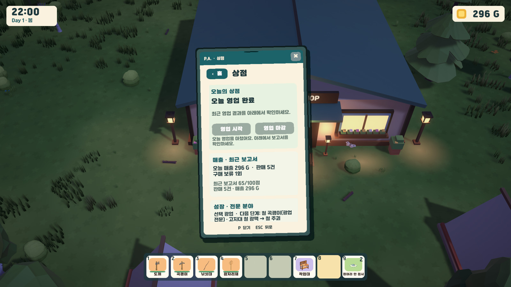 | 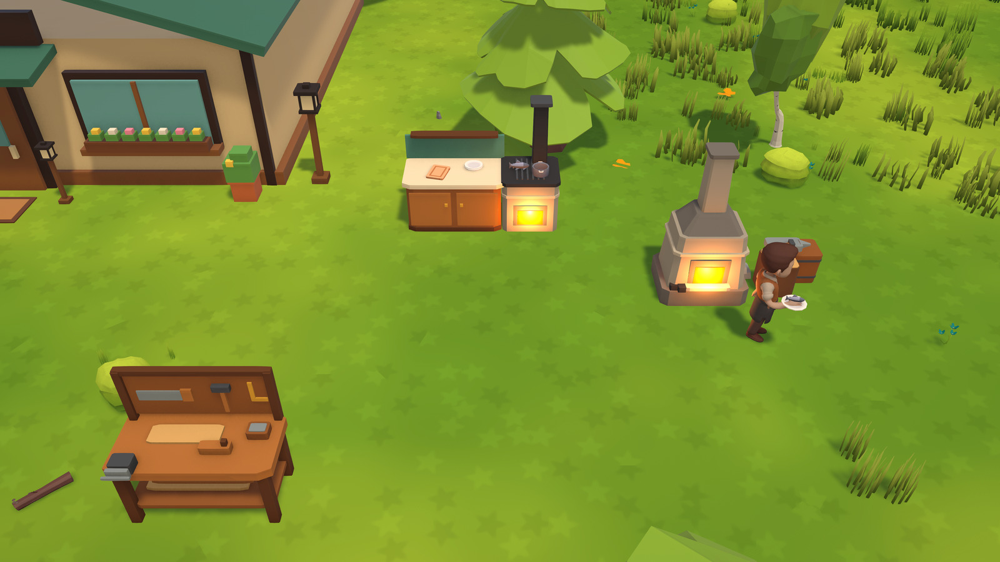 |

</details>

## 여기까지 만든 과정

이전 정착 프로토타입에서는 작은 섬에서 건물을 놓고 판매가 되는지를 확인했습니다. 이후 탐험할 수 있는 섬과 정착 동선을 연결하고, 채집과 제작, 밤 영업을 한 번의 플레이로 묶었습니다. 최근에는 해안과 식생, 생물의 행동, 가게의 생활감에 시간을 썼습니다.

| 이전 정착 화면 | 현재의 정착 화면 |
| --- | --- |
| 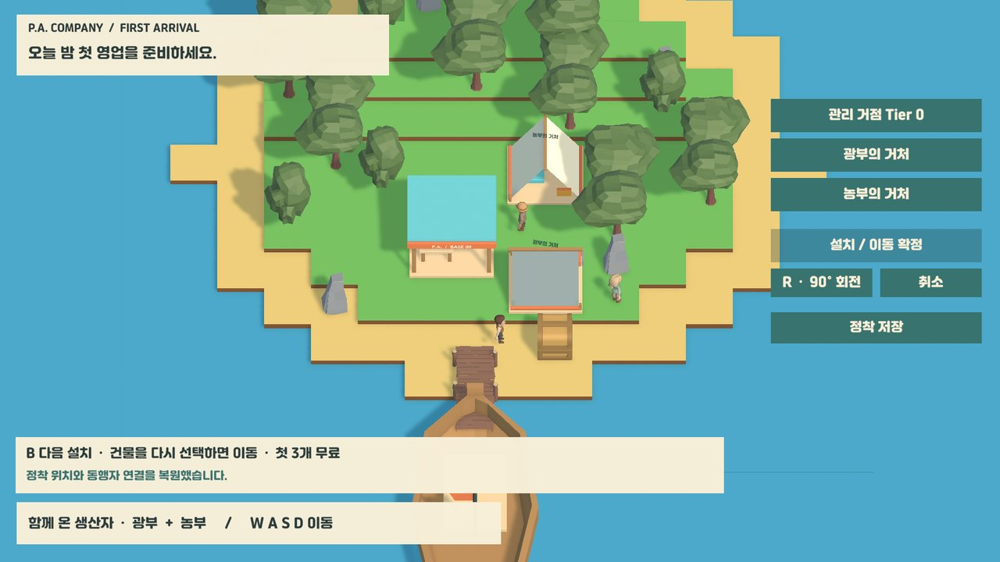 |  |

서로 다른 시기의 빌드·맵·카메라로 찍은 개발 기록입니다. 같은 조건에서 성능이나 화질을 비교한 화면은 아닙니다.

개발 중 내린 결정과 수정 과정은 [월별 개발 로그](Docs/04_DEVELOPMENT_LOG/README.md)에 남겼습니다. [게임 기획](Docs/01_GAME_DESIGN/README.md), [아이템과 도감](Docs/01_GAME_DESIGN/Content/COLLECTION.md), [기능별 구현 문서](Docs/02_IMPLEMENTATION/README.md)에서도 이어 볼 수 있습니다.

## 실행하기

1. 이 저장소를 내려받아 **Unity 6000.3.2f1**로 엽니다. 패키지 목록은 [manifest.json](Packages/manifest.json)에 있습니다.
2. `Assets/Scenes/Prototype_FirstDay.unity`를 열고 Play를 누릅니다.
3. 타이틀에서 **새 게임**을 선택하면 출항 교육부터 시작합니다.

| 조작 | 키 |
| --- | --- |
| 이동 / 달리기 | WASD 또는 방향키 / 왼쪽 Shift |
| 섬에서 상호작용·도구 사용 / 점프 | E / Space |
| 손에 들 물건 선택 / 빈손 | 숫자 1~9 또는 마우스 휠 / X |
| 가방 / 휴대폰 | I 또는 Tab / P |
| 배치 | 마우스로 위치 지정 · E 확정 · R 회전 · Esc 또는 우클릭 취소 |

출항 교육과 개별 화면의 조작은 화면 안내를 따릅니다. 저장·이어하기는 게임 내 메뉴를 사용합니다. Windows 실행 파일은 저장소에 포함하지 않았습니다. 빌드 진입점은 [PA_ExhibitionBuild](Assets/Editor/PA_ExhibitionBuild.cs)의 `BuildBatch`입니다.

## 개발과 에셋 출처

기획과 게임의 방향, 작업 범위와 결과 검수는 직접 맡고, 코드·문서 작성과 반복 작업에는 Claude Code와 Codex를 사용했습니다. 외부 에셋을 가져와 연결한 부분과 프로젝트용으로 제작한 모델·도구를 함께 사용합니다.

자연 에셋 일부는 Quaternius의 CC0 자료입니다. 캐릭터와 건물 일부에는 Tripo 생성 에셋을 사용했으며, 개별 상업 이용 증빙은 출시 전에 정리할 항목으로 남아 있습니다. 현재 플레이어 이동 모션에는 Bandai Namco Research Motion Dataset의 **CC BY-NC 4.0** 자료가 포함되어 있어 상업 출시 전 교체가 필요합니다. [에셋 출처 대장](Docs/05_ASSET_PROVENANCE/ASSET_AND_TOOL_PROVENANCE.md) · [모션 원문·라이선스](Assets/Art/External/BandaiNamcoResearch/README.txt)

본문의 최신 이미지는 2026년 11월 9일 검증 빌드 r258의 실제 Windows 게임 화면입니다. 일부 화면은 HUD를 숨겼으며, 웹 표시용으로 크기와 JPEG 용량만 줄였습니다. [이미지별 출처와 촬영 조건](Docs/Portfolio/2026-11/README.md)
